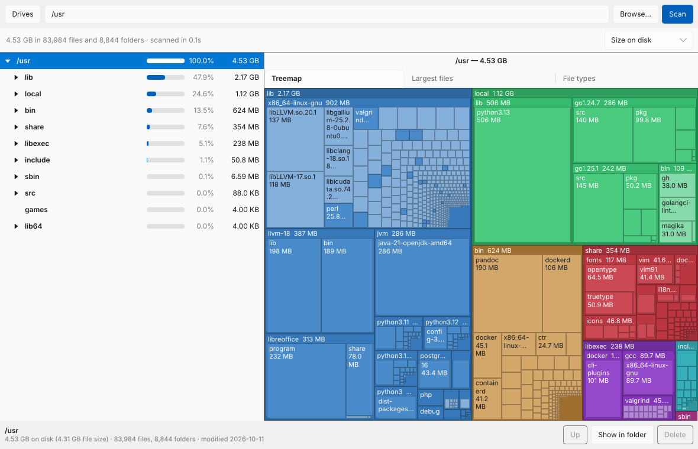
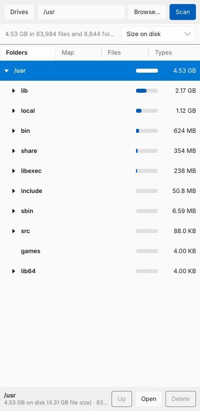
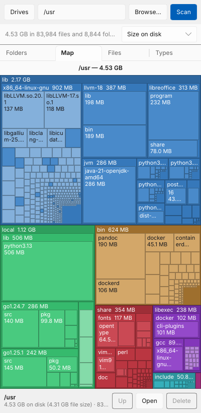

# DiskTree

A fast disk space analyzer in the spirit of TreeSize, written in Rust with a
[Slint](https://slint.dev) UI. One codebase runs on **Windows, macOS, Linux and Android**.



| Phone layout: folders | Phone layout: treemap |
|---|---|
|  |  |

> "DiskTree" is a working name. TreeSize is a trademark of JAM Software, so
> don't ship under that name.

## Features

- **Parallel scanner**: about 190k files in 0.2 s on a warm cache. Scanning a
  whole drive is limited by the disk, not the CPU.
- **Folder tree** sorted by size, with percentage bars. Folders expand in place,
  and very large folders fold their smallest items into one row.
- **Treemap** of the selected folder, three levels deep. Click a block to zoom
  in, and use **Up** to zoom out.
- **Largest files** and **file types** (size by extension) for the selected folder.
- **Size on disk vs. file size**, switchable. Compressed, sparse and cloud-only
  files differ a lot between the two.
- **Delete**: moves to the Recycle Bin or Trash on desktop, and permanently
  deletes (after confirming) on Android. Totals update without rescanning.
- **Show in folder** opens Explorer, Finder or the Linux file manager.
- Flags unreadable folders, other filesystems, cloud-only files (OneDrive,
  iCloud) and hard links. Hard links are counted once.
- **Phone layout** with tabs below 760 px width, so it also works on small
  desktop windows.
- **Command-line tool** (`disktree`) sharing the same core.

## Platform notes

| Platform | What gets scanned | Notes |
|---|---|---|
| Windows | Any drive or folder | Detects OneDrive placeholders; asks Windows for the real size of compressed and sparse files. |
| macOS | Everything, once Full Disk Access is granted | Grant it in System Settings → Privacy & Security for the full picture. Detects iCloud "dataless" files. |
| Linux | Anything you can read | Stays on one filesystem by default (skips `/proc`, other mounts) and counts hard links once. |
| Android | All shared storage and SD cards | Needs **All files access** (Android 11+). `Android/data` and other apps' private data stay hidden; that's an Android rule. |
| iOS | — | Not planned: the iOS sandbox doesn't allow scanning the device. |

## Building

You need a recent stable Rust (1.92+).

**Linux** also needs the fontconfig headers:

```sh
sudo apt install libfontconfig1-dev   # Debian/Ubuntu
sudo dnf install fontconfig-devel     # Fedora
```

### Desktop app

```sh
cargo run --release -p disktree-app            # opens the drive picker
cargo run --release -p disktree-app -- ~/Videos   # scans a folder right away
```

The binary is `target/release/disktree-gui`. On Windows release builds it
doesn't open a console window.

### Command line

```sh
cargo run --release -p disktree-cli -- /usr --depth 2 --top 10
```

```
Scanned /usr in 0.64s: 83,965 files, 8,842 folders
Total: 4.31 GB (4.53 GB size on disk)

  4.53 GB  100.0%  ████████████████████  /usr
  2.17 GB   47.9%  █████████▋            ├── lib/
  1.12 GB   24.6%  ████▉                 ├── local/
   624 MB   13.5%  ██▊                   ├── bin/
```

Run `disktree --help` for all options (`--apparent` for file sizes,
`--cross-filesystems`, `--min-percent`, …).

### Android

1. Install the Android SDK and NDK (Android Studio's SDK Manager is the easiest
   way). Then set `ANDROID_HOME` to the SDK, `ANDROID_NDK_ROOT` to the NDK, and
   make sure a JDK 17 `javac` is on your `PATH` (or set `JAVA_HOME`).
2. Install the tooling:
   ```sh
   rustup target add aarch64-linux-android x86_64-linux-android
   cargo install cargo-apk
   ```
3. Build and run on a connected phone (USB debugging on):
   ```sh
   cargo apk run -p disktree-app --lib --target aarch64-linux-android
   ```
   Use `--target x86_64-linux-android` for the emulator.

On first launch the app asks for **All files access**. Tap *Grant access*, turn
it on in the screen that opens, and come back; the scan starts by itself.

Publishing to Google Play requires declaring why the app needs All files access.
Disk analyzers and file managers are an accepted use, but it goes through
review. Sideloading and F-Droid don't have that step.

## CI and releases

- **CI** (`.github/workflows/ci.yml`) runs formatting, clippy and tests on
  Windows, macOS and Linux, and builds an arm64 APK you can download from the
  run's artifacts.
- **Release** (`.github/workflows/release.yml`) runs when you push a tag like
  `v0.1.0`. It builds Windows, macOS and Linux archives plus arm64 and x86_64
  APKs, and attaches them to a GitHub release.

APKs are signed with a throwaway key unless you add two repository secrets:
`ANDROID_KEYSTORE_BASE64` (your keystore, base64-encoded) and
`ANDROID_KEYSTORE_PASSWORD`. Android only installs an update if it's signed
with the same key as the installed app, so set these before you share builds.

## Project layout

```
crates/core   scanner, tree model, stats, treemap layout (no UI)
crates/cli    `disktree` command-line tool
crates/app    Slint app; ui/app.slint is the whole UI, src/controller.rs the logic
```

See [ARCHITECTURE.md](ARCHITECTURE.md) for how the pieces work.

## Licensing

No license has been chosen for this project yet. Note that Slint is available
under GPLv3, under a royalty-free license for desktop and mobile apps that
requires attribution (for example a "Made with Slint" badge in the About box or
on the website), or under a paid license. Pick the one that matches how you
want to distribute DiskTree.
