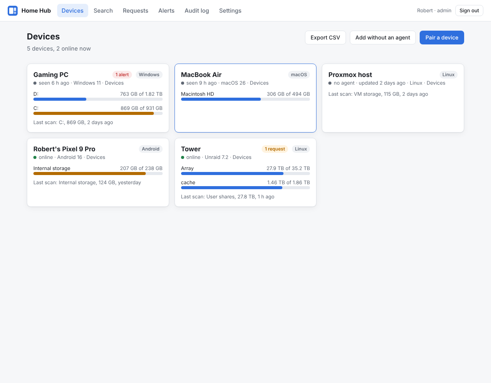
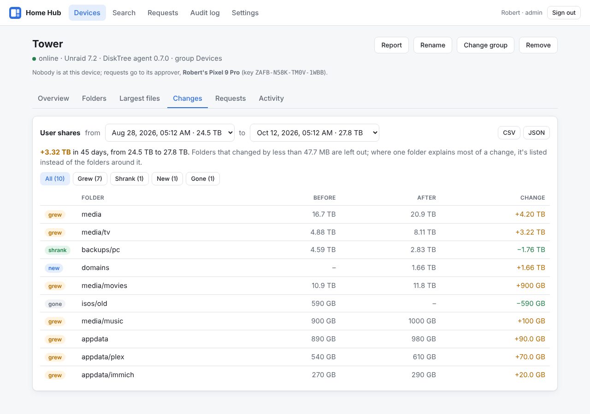
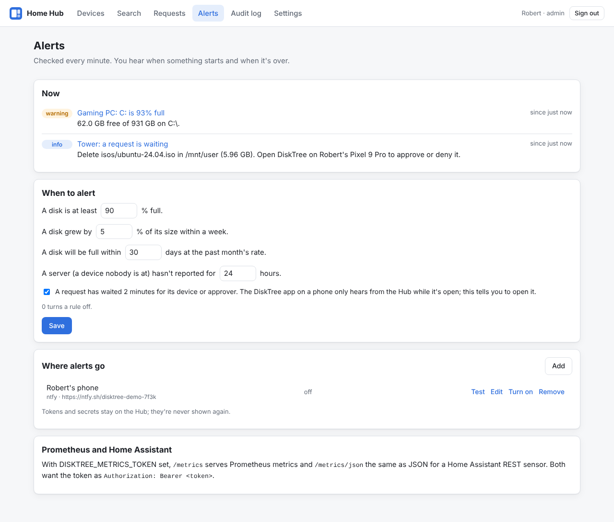
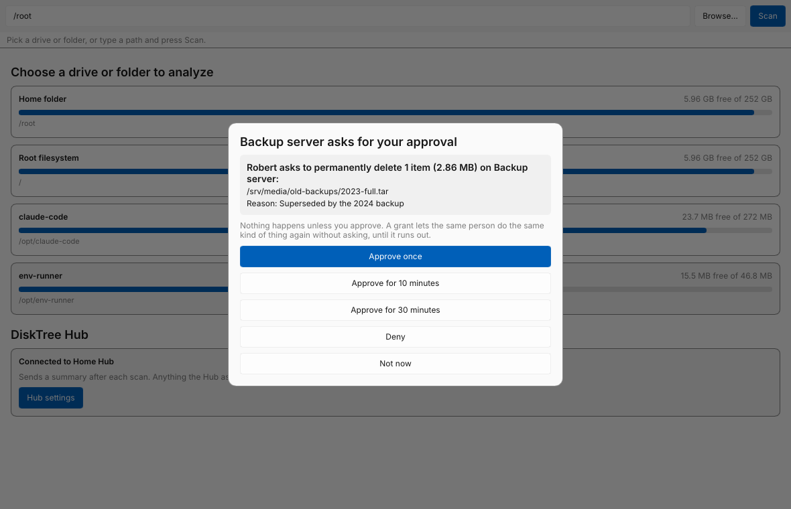
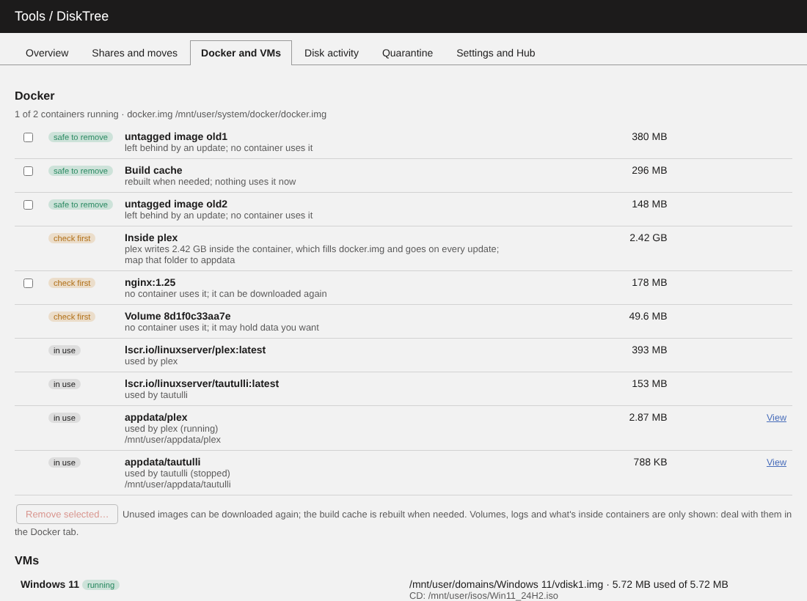

# FreeSize

A fast disk space analyzer in the spirit of TreeSize, written in Rust with a
[Slint](https://slint.dev) UI. One codebase runs on **Windows, macOS, Linux and Android**.


| Phone layout: folders | Phone layout: treemap |
|---|---|
|  |  |

> FreeSize was called DiskTree until 0.8.6. TreeSize is a trademark of JAM
> Software, so don't ship under that name.

### Coming from DiskTree

Each part takes over what DiskTree kept, the first time it starts:

- **Windows, macOS and Linux**: the app and the command line move DiskTree's
  data folder (scan history, drive history, the Hub pairing) to FreeSize's.
  Run `freesize` and `freesize-gui` from now on; the old executables can go.
- **Android**: FreeSize is a new app to Android (its package is
  `io.github.mcgeaverbeaver.freesize`), signed with the same key. Install it,
  connect it to the Hub again, then uninstall DiskTree. The app history in
  `Documents/DiskTree` carries over; installers saved in `Download/DiskTree`
  stay where they are and are never offered as junk.
- **Unraid plugin**: check for updates as usual. The last DiskTree update
  installs the FreeSize plugin within a minute, which takes over the
  settings and the Hub pairing from `/boot/config/plugins/disktree` and
  removes DiskTree. The page is under Tools, FreeSize.
- **The Hub**: the image is `ghcr.io/mcgeaverbeaver/freesize-hub`; the old
  name gets the same image for a while, so an existing container updates in
  place. Settings named `DISKTREE_…` still count where the `FREESIZE_…` name
  isn't set, and the Authentik groups `disktree-admins` and
  `disktree-viewers` still count while the group settings are left at their
  defaults. A Hub run without Docker moves its data folder like the apps.
  Pairing links and QR codes starting `disktree://` still pair.
- **Linux services**: the units are `freesize-agent.service` and
  `freesize-hub.service` now. Install them as under Running the Hub, keeping
  `--state` and the data folder pointing at the old paths, or move those.
- **What keeps its old name**: the quarantine folder on each disk
  (`.disktree-quarantine`, since its records name the files inside by full
  path), and the names inside the protocol: the request headers, the
  webhook's `X-DiskTree-Signature`, the Prometheus metrics (`disktree_…`)
  and the dashboard's cookie.

## Features

- **Parallel scanner**: about 190k files in 0.2 s on a warm cache. Scanning a
  whole drive is limited by the disk, not the CPU.
- **Folder tree** sorted by size, with percentage bars. Folders expand in place,
  and very large folders fold their smallest items into one row.
- **Treemap** of the selected folder, three levels deep. Click a block to zoom
  in, and use **Up** or the path above the map to zoom out. The bigger blocks
  carry an icon: the app or game a folder belongs to, or the kind of content
  (videos, photos, music, archives, disk images, games, code, programs).
  Folders a tool can rebuild get a green outline.
- **Bubbles**, the switch in the map's corner: the same folder as circles
  sized by space, the biggest in the middle, each showing what's inside it.
  Tap one to zoom in. Small items share one "more" bubble.
- **App and game icons** for folders: Android apps' folders in
  `Android/media`, `data` and `obb`; Steam games (named by Steam's manifests,
  with the icon from Steam's library cache) on every platform; on Linux,
  folders in `~/.config`, `~/.cache`, `~/.local/share`, `~/.var/app`, `/opt`
  and similar matched to installed apps; on Windows, folders in Program Files
  and AppData by the program inside; on macOS, `.app` bundles and their
  folders in `~/Library`.
- **Largest files** and **file types** (size by extension) for the selected folder.
  The Types tab also breaks the folder down by the year files were last
  changed and by size band. Tap any row to list just those files, biggest
  first, then select one to open or delete it.
- **Clean up** tab for the scanned folder: where the system and apps keep
  caches they can do without (`Windows.old`, update and browser caches,
  shader caches, …), folders that tools rebuild (`node_modules`, Rust
  `target`, `.gradle`, Python virtual environments, package manager caches,
  …) with how to get each back, large files nobody has changed in over a
  year, a duplicate file finder and a finder for photos that look alike.
  Each is a card; open one to tick what should go, one by one or all at
  once (every extra copy of the duplicates, only the EXE duplicates, all
  but the largest of each set of similar photos). Everything ticked is
  listed once more before it goes to the quarantine. See
  [Clean up tab](#clean-up-tab).
- **Clean junk**, on the start screen: one button finds the junk in the
  known places (temporary files, crash dumps, browser and app caches,
  shader caches, build caches, the trash, old installers and downloads)
  in seconds, without a scan. Everything is sorted by category with a
  tick box, a line about what cleaning it means and whether it refills,
  and opens to its exact paths. Safe items are ticked; "check first"
  items aren't and go to the quarantine; what the system's own tool
  should remove gets a button to that tool. An optional weekly or daily
  check says when junk piles up; nothing is ever cleaned on its own. See
  [Clean junk](#clean-junk).
- **Changes** since an earlier scan of the same folder: what grew, what's
  new, what shrank or went away. Bubbles show how much a folder grew. See
  [Changes](#changes).
- **Selection**: select files and folders from any view, look them over in
  one list, then delete them all or move them all to another drive, keeping
  their folders. The last move can be put back. See [The selection](#the-selection).
- **Export** a report (HTML), a spreadsheet (CSV) or the whole scan (ncdu's
  JSON format), and open saved scans again, including ones made with
  `ncdu -o` on a machine without FreeSize. See
  [Export and saved scans](#export-and-saved-scans).
- **Drive trends** on the start screen: how much each drive grew over the last
  30 days and, at that rate, when it will be full. FreeSize records each
  drive's used space once a day it's opened, so trends appear after a few
  days.
- **Size on disk vs. file size**, switchable. Compressed, sparse and cloud-only
  files differ a lot between the two.
- **Delete**: moves the item to FreeSize's quarantine (after confirming),
  on every platform. **Put back** restores it byte for byte; the space is
  freed when you empty the quarantine, never on its own. Totals update
  without rescanning.
- **Open** shows the selected file in the app that normally opens it (photo
  viewer, PDF reader, video player), so you can check it before deleting.
  **Show in folder** opens Explorer, Finder or the Linux file manager.
- Flags unreadable folders, other filesystems, cloud-only files (OneDrive,
  iCloud) and hard links. Hard links are counted once.
- **Phone layout** with tabs below 760 px width, so it also works on small
  desktop windows.
- **Apps & system breakdown (Android)**: how the whole phone's storage
  divides up between apps, your files, the system and free space. Every app is
  listed with its code, data and cache sizes.
- **App cleanup (Android)**: apps you haven't opened in 3 months or never
  opened, apps no store can give back, and a history of removed apps. Tap an
  app to see when you last used it and where it came from, then uninstall,
  archive, save its APK or clear its cache. See
  [Cleaning up apps](#cleaning-up-apps).
- **Growth (Android)**: a chart of the phone's storage over time with a
  forecast of when it fills up, and a *Growing fast* group of apps that grew
  by 100 MB or more in a month.
- **Apps as bubbles (Android)**: any app group can be shown as bubbles of
  app icons, sized the way the group ranks them. Tap an app to see what its
  space is made of: the app, its data, its cache and the files it saved.
- **Old screenshots and chat media (Android)**: cards that open screenshots
  older than a month, and the photos and videos chat apps saved, to look
  through before deciding what goes.
- **Command-line tool** (`freesize`) sharing the same core.
- **FreeSize Hub**: one web dashboard for every device's storage, with
  history, search, alerts and requests that each device approves itself
  (see [FreeSize Hub](#freesize-hub)).

## Platform notes

| Platform | What gets scanned | Notes |
|---|---|---|
| Windows | Any drive or folder your account can open | Folders it can't open are marked "no access", counted and named under Clean up, with **Scan as administrator**: a new FreeSize window, after Windows asks, that reads them (it turns on the backup privilege, so even folders that keep administrators out are listed). System Volume Information stays closed, and Windows' reserved storage (about 7 GB) is seen by no program. Detects OneDrive placeholders; asks Windows for the real size of compressed and sparse files. |
| macOS | Everything your account can open, once Full Disk Access is granted | Without Full Disk Access the Clean up tab says so and opens the setting. Other users' folders need an administrator: **Scan as administrator** asks for your password, scans in the background and opens the result as a saved scan. (`sudo freesize / --export scan.json` does the same by hand.) Detects iCloud "dataless" files. |
| Linux | Anything you can read | Stays on one filesystem by default (skips `/proc`, other mounts) and counts hard links once. **Scan as root** (through `pkexec`) scans everything in the background and opens the result as a saved scan; `sudo freesize / --export scan.json` does the same by hand. The window itself never runs as root. |
| Android 8.0+ | All shared storage and SD cards, plus sizes for every app and the system | Files need **All files access** (Android 11+). Apps' private data can't be opened as files on Android, so it's measured through Android's storage statistics instead, which need **Usage access**. |
| iOS | — | Not planned: the iOS sandbox doesn't allow scanning the device. |

## Installing

- **Windows and Linux**: download `freesize-windows-x86_64.zip` or
  `freesize-linux-x86_64.tar.gz` from the
  [latest release](https://github.com/McGeaverBeaver/FreeSize/releases/latest),
  unpack it anywhere and run `freesize-gui` (`freesize-gui.exe`). It's a
  single file with no installer; the `freesize` command line is beside it.
  On Windows, SmartScreen may warn about a download it hasn't seen before:
  *More info → Run anyway*. Linux needs fontconfig, which every desktop has.
  Later releases install from the app: see [Updates](#updates).
- **Android**: see [Installing on an Android phone](#installing-on-an-android-phone).
- **Unraid**: the plugin and the Hub's container are in Community
  Applications; see [FreeSize for Unraid](#freesize-for-unraid).
- **macOS**: no download yet; build it yourself (nobody here has a Mac to
  test on). Building anything from source is in
  [docs/DEVELOPING.md](docs/DEVELOPING.md).

## Command line

The `freesize` command line is in every desktop download, beside the app.

```sh
freesize /usr --depth 2 --top 10
```

```
Scanned /usr in 0.64s: 83,965 files, 8,842 folders
Total: 4.31 GB (4.53 GB size on disk)

  4.53 GB  100.0%  ████████████████████  /usr
  2.17 GB   47.9%  █████████▋            ├── lib/
  1.12 GB   24.6%  ████▉                 ├── local/
   624 MB   13.5%  ██▊                   ├── bin/
```

Run `freesize --help` for all options (`--apparent` for file sizes,
`--cross-filesystems`, `--min-percent`, …). `--cleanup` adds rebuildable
folders and files not changed in a year, and `--duplicates` finds duplicate
files of 1 MB or more (it reads them, so it takes a while). Both only list;
a scan never deletes anything.

`freesize junk` is the junk cleaner (see [Clean junk](#clean-junk)) on the
command line: it lists what the known places hold by category, with each
rule's id, size and what cleaning it means, ticked where it's safe, and
touches nothing. `freesize junk --clean` deletes what's ticked after
showing it and asking; `--also RULE` adds a rule by its id ("check first"
rules go to the quarantine on their disk, where `freesize agent` or the
Hub can put them back), `--only RULE` limits the look, `-y` skips the
question and `--json` prints the findings with every path.

`freesize nextcloud` prints what this machine keeps of its Nextcloud
folders, as the agent reports it to the Hub (see
[Copies](#copies-is-there-another-copy)): each account the desktop client
is signed in to, its sync folders, and per folder how much is stored here
against how much is online-only; `--json` prints the report itself.

For scripts, spreadsheets and Home Assistant:

```sh
freesize ~/Videos --json                 # everything above as JSON
freesize / --export root-scan.json       # save the scan (ncdu's format)
freesize --import root-scan.json         # look at a saved scan again
ssh server ncdu -o- -x /srv > srv.json && freesize --import srv.json
```

## Using the app

### Clean up tab

After a scan, the **Clean up** tab (**Clean** on phones) opens on a card
for each kind of thing it found, with how much it could free and how many
of its items are ticked. **Review** opens a card as its own page (**‹ All**
goes back), where every row has a tick box and the page has buttons to
tick many at once:

- **Select all** for rebuildable folders and old files, **Select the safe
  ones** for system caches (rows the system's own tool should remove have no
  tick box).
- **Select extra copies** for duplicates: every copy but one in each set.
  The copy kept is marked **Keep**: one outside caches and temporary
  folders, not named like a copy (`photo (1).jpg`, `x - Copy.doc`), and the
  oldest. **Show** lists one type only (*EXE files · 12 sets, 1.2 GB*), and
  the button then ticks the extra copies of that type only. Each set also
  has its own **Select extras**.
- **Select all but the largest** for similar photos, which are shown side by
  side as big previews so they can be compared; each set has its own button
  too.
- **Clear** unticks what the page lists.

When every copy of a duplicate (or every photo of a set) is ticked, the set
says so in orange, and so does the confirmation. Ticked items go into the
selection (see [The selection](#the-selection)): its bar shows what's ticked
everywhere, and **Review…** lists each item once more, with **Keep** to
take one off, before anything is moved to the quarantine. Double-click a
row, or select it and use Open, to look at a file first. A scan opened
from a file is read-only, so it has no tick boxes.

The cards are:

- **Folders FreeSize couldn't read**, when there are any: how many, which
  (select one to see where it is), and the way to a fuller scan on this
  platform (see [Platform notes](#platform-notes)). A scan with more rights
  opens read-only on macOS and Linux, since it was made as root; on Windows
  it's a second window, as administrator, where deleting follows the same
  rules as always. The status line counts what couldn't be read and points
  here.
- **Rebuildable folders**: build output, installed packages and caches that a
  tool makes again when needed, each with the command that does it, for
  example *node_modules · npm install puts them back*. Folders are matched by
  name and, where the name is common, by what sits next to them: `target`
  only next to a `Cargo.toml`, `build` only next to a Gradle file.
- **Not changed in over a year**: the largest files (10 MB and up) whose
  modification date is more than a year ago.
- **Duplicate files**: press *Find duplicates* to compare files of 1 MB or
  more. Files are grouped by size, then by a quick hash of their first and
  last 64 KB, and only then hashed in full, so most files are never read
  completely. Hard links to the same file aren't duplicates. Cloud-only
  files are skipped so nothing is downloaded.

- **System and app caches**: known places where the system and apps keep
  files they can do without. On Windows: `Windows.old`, the upgrade and
  update download folders, Delivery Optimization, temp folders, crash dumps,
  `hiberfil.sys`, browser caches (Chrome, Edge, Brave, Firefox) and GPU
  shader caches (Steam's too). On macOS: the Trash, app logs, old iPhone
  backups, Xcode archives, device support files and simulators, downloaded
  macOS updates. On Linux: the thumbnail cache, the Trash, Flatpak app
  caches, downloaded packages and the system journal. Each says how to
  remove it; some are marked *check first* or *don't delete* and name the
  system tool to use instead (Settings → System → Storage → Temporary files
  for `Windows.old` and update files, the power settings for
  `hiberfil.sys`).
- **Not in any file**: after scanning a whole drive, how much of the used
  space no file accounts for, and why: ZFS and btrfs snapshots (how much
  they hold that nothing else uses, with btrfs quotas on), Windows restore
  points and shadow copies, local Time Machine and other APFS snapshots,
  macOS's purgeable space, space the file system reserves, and folders
  FreeSize couldn't read (listed above it).
- **Similar photos**: press *Find similar photos* to group photos that look
  alike, such as bursts, retakes and the same picture saved at another size.
  Each photo gets a small fingerprint of its brightness pattern; most camera
  photos carry a small preview in their EXIF data, which is read instead of
  the whole picture, so even thousands of photos take seconds. Every group
  shows the photos with a preview, the largest first. Similar isn't
  identical, so open them before choosing.

Tap a row to select it in the tree, then use Open to look at it, or Delete
or Select from the bar at the bottom. Delete moves it to the quarantine.

- **Quarantine**, at the top whenever it holds something: each batch of
  deleted items with when, where from and how much, with **Put back** and
  **Empty** per batch and **Empty all** on the heading. Emptying asks first
  and lists the paths. On a desktop the quarantine for the disk FreeSize's
  data is on lives in that data folder; other disks, and a phone's shared
  storage, get a `.disktree-quarantine` folder at their top, as servers
  do. Deletes a Hub asks for land in the same quarantine, as a batch under
  the request, so the dashboard's Put back and Empty work on them too.

### Clean junk

On the start screen, **Find junk** looks in the known places on this
platform, which takes seconds and needs no scan: temporary files, crash
dumps and error reports, update leftovers, the thumbnail cache, browser
caches (Chrome, Edge, Brave, Firefox, Safari, Chromium), the caches of
well-known apps (Spotify, Discord, Slack, Teams, VS Code, Zoom's logs,
Adobe's media cache), shader caches and Steam's finished downloads,
developer caches (npm, pip, cargo, Gradle, NuGet, Yarn, Go, Homebrew,
CocoaPods, Xcode's derived data, device support files, archives and
simulators), the trash, old installers, downloads not changed for three
months and old screen recordings. Linux adds the system journal, Flatpak
app caches and the apt, dnf and pacman package caches; macOS old iPhone
backups and downloaded macOS updates; Windows `Windows.old`, Windows
Update's downloads, Delivery Optimization and the hibernation file.

The screen lists what it found by category (System, Browsers, Apps, Games,
Developer tools, Trash and downloads), each rule with its size, a line
about what it is and what happens after cleaning ("pages load from the
internet again the first time; you stay signed in"), and whether it
refills within days, so the space won isn't oversold. A rule opens to its
exact paths, each with **Show** to look at the files first.

- **Safe** rules are ticked: caches and temporary files, which their apps
  make again. They're deleted after the confirmation, which says so (in a
  quarantine they'd free nothing).
- **Check first** rules (old downloads, installers, the trash, Steam's
  finished downloads) are never ticked by default. Ticked, they go to the
  quarantine, where **Put back** restores them.
- **Use the tool** rules (`Windows.old` and Windows Update's files, the
  hibernation file, macOS updates, the apt cache, the journal) can't be
  ticked: a button opens the system's settings page or shows the command.
- A rule whose program is running (Chrome's cache while Chrome is open)
  is skipped until it's closed, and says so.
- **Leftovers of removed programs** (Apps, check first) are the settings
  and caches a program left in AppData, `~/Library` or `~/.config`,
  `~/.cache` and `~/.local/share` after it was uninstalled. FreeSize only
  calls a folder a leftover when it's sure whose it was: it saw the program
  installed on an earlier look and matched the folder to it then (the
  list is kept in `programs.json` in its data folder, so the rule grows
  more useful the longer FreeSize is around), or the folder is named by
  the program's own id (a Flatpak under `~/.var/app`, a snap under
  `~/snap`, a bundle id under `~/Library/Containers`). The program must be
  gone now and nothing in the folder changed for two weeks. Each path says
  which program ("Discord, installed until 2026-09-20"), and the folders
  go to the quarantine, so one a program still needs comes back with Put
  back. Nothing is offered on a machine whose list of programs couldn't
  be read.

**Clean** asks once, then frees what it can and reports what was freed,
what went to the quarantine, what was skipped because a file was in use
and how much of it will refill. **Reminder** on the card checks once a
week or once a day and says on the start screen how much junk there is
to review ("2.4 GB of junk to review, 1.6 GB safe to clean"); it never
cleans anything by itself. Registry cleaning, memory "boosters" and
browser history, cookies and saved passwords are left out on purpose: they
free nothing, or sign you out.

On phones the same rules show as Free up space cards (see
[Cleaning up apps](#cleaning-up-apps)); on an Unraid server the Quarantine
tab lists the trash folders in the shares; and a paired device's junk is
on the Hub's Junk tab, with an alert when it grows past a limit. Tick the
rules to clean (**Tick the safe ones** does the safe ones, **Tick all
here** a category) and **Ask to clean…** lists them once and sends a
request per rule, each approved on the device. The Hub's Largest files tab can list one file type and
tick every file it lists.

### Changes

FreeSize keeps the sizes of the 10,000 biggest folders of every scan (not
every file), the last 12 scans of each scanned folder, in FreeSize's data
folder under `scans/`. When a folder has been scanned before, the
**Changes** tab compares this scan with an earlier one (pick which): how much
the whole folder grew, the folders that grew or are new, and the ones that
shrank or went away. A folder is skipped when one folder inside it explains
almost all of its change, so the list points at where the change is. Small
changes (a thousandth of the folder, between 1 MB and 50 MB) aren't listed.
In the bubble view, folders that grew or shrank noticeably show by how much,
for example *12.4 GB · +2.1 GB*.

### The selection

Select a file or folder anywhere and press **Select** (or tick it on the
Clean up tab) to add it to the selection; a bar shows how many items and
how much space it holds. When a files list is filtered (a type, an age, a
size, old screenshots), **Select all** adds every listed file. **Review…**
lists everything selected, each with **Keep** to take it off the list, with
two ways to act on all of it:

- **Delete all**: asks first, then moves everything to the quarantine as one
  batch, to put back together.
- **Move all**: pick a folder, for example on another drive or a NAS share.
  Each item keeps its folders below the scanned one (`Videos/2023/trip.mp4`
  goes to `<destination>/Videos/2023/trip.mp4`). Within a drive that's a
  rename; across drives each item is copied, checked and only then removed.
  Nothing is overwritten. **Put back** returns the last move; its record is
  `last-move.json` in FreeSize's data folder. On Android, Move offers a
  `FreeSize moved` folder on internal storage or on each SD card or USB
  drive.

### Export and saved scans

**Export**, next to the size switch, saves the folder you're looking at as:

- **Report (HTML)**: one page with the biggest folders and files, file
  types, years, the Clean up suggestions and the changes, to read or share.
- **Spreadsheet (CSV)**: the 10,000 biggest folders and files of 1 MB or
  more, with sizes, file counts and dates.
- **Scan file (JSON)**: the whole scan in the format of ncdu's `-o` option.

On desktops a save dialog asks where; on Android files go to
`Download/FreeSize`. To open a scan file, type its path (ending in `.json`)
and press Scan. Saved scans open read-only: nothing in them can be opened,
deleted or selected, since the files may be on another machine. Scans made
with `ncdu -o` (1.x or 2.x JSON) open the same way, so a server or router
without FreeSize can be scanned with ncdu and looked at here.

### Android

The APK builds on Linux, or on Windows inside WSL: run `wsl --install` once in
an administrator PowerShell, restart, and use the Ubuntu terminal it adds. In
WSL, keep the repository in your Linux home folder rather than under `/mnt/c`,
which is much slower.

One-time setup (Debian/Ubuntu and WSL; other distros need the same packages):

```sh
sudo apt install curl unzip openjdk-17-jdk-headless build-essential   # or openjdk-21-…
curl --proto '=https' --tlsv1.2 -sSf https://sh.rustup.rs | sh   # if you don't have Rust
git clone https://github.com/McGeaverBeaver/FreeSize
cd FreeSize
scripts/android/setup-linux.sh
```

`setup-linux.sh` downloads the Android command-line tools, SDK platform 36,
build tools, NDK and adb into `~/Android/Sdk` (a few GB), then adds the Rust
Android targets and `cargo-apk`. It doesn't need root. To use an existing SDK,
for example Android Studio's, set `ANDROID_HOME` to it first.

Build:

```sh
git pull
scripts/android/build-apk.sh      # -> target/release/apk/FreeSize.apk
```

The first build takes several minutes; later ones only rebuild what changed.
Since 0.14 the script also compiles the app's one Java class with the JDK's
`javac` and the build tools' `d8`, and puts the APK together with the
manifest in `crates/app/android`. It also creates the signing key that every later build reuses (see
[Android signing key](docs/DEVELOPING.md#android-signing-key)), so new builds install over the
old one and keep FreeSize's permissions. Releases up to 0.1.3 were signed
with a different key, so uninstall such a copy once first.

To get the APK onto the phone, either:

- copy it over (USB cable, Google Drive, …) and open it on the phone. From
  WSL, `cp target/release/apk/FreeSize.apk /mnt/c/Users/<you>/Downloads/` puts
  it in your Windows Downloads folder.
- or install it over Wi-Fi with adb. Turn on Developer options (Settings →
  About phone → tap *Build number* seven times), then Settings → System →
  Developer options → *Wireless debugging* → *Pair device with pairing code*:

  ```sh
  adb=~/Android/Sdk/platform-tools/adb
  $adb pair 192.168.1.50:37123      # address and code from the pairing dialog
  $adb connect 192.168.1.50:41234   # address on the Wireless debugging screen
  $adb install -r target/release/apk/FreeSize.apk
  ```

`build-apk.sh` produces one APK for every device: arm64 phones plus x86_64
emulators and Chromebooks. It links the native code for 16 KB memory pages and
runs `scripts/android/check-apk.sh`, which fails the build if the APK would be
rejected by a phone or by Google Play. To see the app's log, run
`adb logcat -s FreeSize`.

Publishing to Google Play requires declaring why the app needs All files access
and why it lists all installed apps (`QUERY_ALL_PACKAGES`). Disk analyzers and
file managers are an accepted use, but it goes through review. Sideloading and
F-Droid don't have that step.

## Installing on an Android phone

1. Download **`freesize-android.apk`** from the latest release. It's one file
   for all phones.
2. Open it. If Android asks, allow your browser or Files app to install unknown
   apps.
3. Google Play Protect may warn that the app comes from an unknown developer.
   Tap *More details → Install anyway*.
4. Start FreeSize, tap **Grant access**, turn on *Allow access to manage all
   files*, and go back. Then pick *Internal storage* or an SD card.
5. To see what apps and the system use, tap **Allow usage access** under
   *Apps & system*, turn FreeSize on in the list, and go back.
6. If the switch is greyed out or Android says *App was denied access* /
   *Controlled by Restricted Setting*, Android is blocking it because the app
   was installed from a downloaded file. Tap **Open FreeSize's app info** in
   FreeSize (or go to Settings → Apps → FreeSize), tap **⋮** in the top
   corner, choose **Allow restricted settings** and confirm with your PIN or
   fingerprint. Then repeat step 5. You only need to do this once per install.

Later releases install from the app: see [Updates](#updates).

### Why a file scan finds less than the phone uses

Android only lets an app read shared storage: photos, downloads, music and the
like. Most of a phone's space is somewhere no app can open as files:

- each app's private data (offline music and videos, chats, game data, caches)
  and its folders under `Android/data` and `Android/obb`;
- installed app code;
- system data, other user profiles and temporary files.

On top of that, the Android OS has partitions of its own outside user
storage. That's why a 128 GB phone shows about 109 GB.

The *Apps & system* section covers all of this with the same storage
statistics Android's Settings app uses:

- Apps: each app's code plus data. Preinstalled apps' code sits on the system
  partition, so only their data counts.
- Your files: shared storage that belongs to no app.
- System & other: the rest of the used space.

Tapping an app opens its settings page, where you can clear its cache, clear
its storage or uninstall it.

The Back gesture steps back through the app: it closes a dialog, stops a scan,
zooms the treemap or the app bubbles out, closes a group of apps, then returns
to the drive list before leaving the app.

### Cleaning up apps

Under *Your apps* on the home screen, the apps are grouped so the space you
can win back is easy to find. Each group opens as its own page; the arrow at
its top or the Back gesture returns to where you were on the home screen.

| Group | What's in it |
|---|---|
| All apps | Every app, biggest first. |
| Not opened in 3 months | Apps you haven't had on screen for 3 months. |
| Never opened | Apps with no use recorded since they were installed (Android keeps about 2 years of usage history). |
| Not from an app store | Apps installed from a downloaded file or a computer. No store can give them back, so save the APK first. |
| Files saved by apps | Photos, videos, downloads and other files each app saved to your storage, with where most of them are. |
| Biggest caches | Apps by cache size, to clear the big ones in their info pages. |
| Growing fast | Apps that grew by 100 MB or more over the last month, fastest first. |
| Removed apps | Apps FreeSize has seen before that are gone, so you can find one again by name. |

Apps that work without being opened are never suggested for removal:
preinstalled apps, apps without an icon, your default home screen, browser,
messaging and phone apps, keyboards, accessibility services, apps that read
notifications (such as watch apps), device admin apps, and archived apps.

Tapping an app shows its size, when it was installed and last opened, its time
on screen over about the last month, where it came from, the files it saved to
your storage, and tips for a few well-known apps (for example that clearing
Signal's storage deletes your messages). Its buttons:

- **Uninstall**: Android asks you to confirm.
- **Archive** (Android 15+, Play Store apps): opens the app's info page, where
  *Archive* removes the app but keeps its data and login. Tapping its icon
  later reinstalls it from the Play Store.
- **Save APK to Downloads** (apps not from a store): copies the app's install
  file to `Download/FreeSize`, so you can install it again later. The app's
  data isn't included.
- **Browse its files** (apps that saved files to your storage): scans the
  folder holding most of them, so you can see and delete them in FreeSize.
- **Open in Play Store** (or the store it came from).
- **App info**: Android's page for clearing the app's cache or data.

**Free up space** lists what can go without touching any app. It needs All
files access:

- **App caches** shows how much cache apps keep and what can actually clear
  it. Android doesn't let one app clear another's cache, and clears caches by
  itself when space runs low. Its cache cleaner (Android 11+), which the card
  opens, only empties the cache folders in shared storage
  (`Android/data/<app>/cache`), usually a small part; the card says how much
  that is (Android 12+) and only offers it when it's worth it. For the rest,
  use *Biggest caches* and Clear cache on each app's info page.
- **Empty the trash** (Android 11+): photos and videos deleted in the last 30
  days still take space until Android removes them for good.
- **Delete old app installers**: `.apk` files in Download. APKs saved with
  FreeSize in `Download/FreeSize` are kept.
- **Clear the thumbnail cache**: `DCIM/.thumbnails`, which gallery apps
  rebuild.
- **Delete leftovers of removed apps**: their folders in `Android/media`.
- **Old downloads**: files in Download not changed for 3 months, and
  **Screen recordings** older than a month, to look through first; some
  may be the only copy.
- **Empty folders**: folders with nothing in them, left by removed apps
  and old downloads.

FreeSize asks before deleting anything, moves what goes to the quarantine,
then measures again.

Two more cards are for things that aren't junk, so they never delete
anything themselves; **Review** opens the files to look through:

- **Look through old screenshots**: screenshots in `Pictures/Screenshots`
  and `DCIM/Screenshots` not changed for a month. Review scans the folder and
  lists just those, biggest first; open any, then select the ones you're
  done with (or *Select all*) and delete them together from the selection.
- **Look through chat media**: photos, videos and voice notes saved by
  WhatsApp, WhatsApp Business, Telegram, Signal, Messenger, Viber, WeChat and
  LINE. Review picks a folder (when there are several) and lists its files,
  biggest first.

**Storage over time** charts apps, your files and the system day by day,
under the storage breakdown. It says how much used space grew over the last
30 days and, when it's growing, about when the storage will be full at that
rate. FreeSize records a sample each day it measures the apps, so the chart
starts with the first two days and the growth figures need a few days.

After you come back from uninstalling an app or from its info page, FreeSize
measures the apps again.

The app history is a small file, `Documents/FreeSize/app-history.json`, with a
second copy in FreeSize's private storage. The first survives uninstalling
FreeSize. Other apps with All files access can read it, so delete it if you
don't want the list of your apps there. FreeSize only notices an app was
removed the next time it measures the apps, so the removal date can be later
than the day you removed it.

| Problem | Cause | Fix |
|---|---|---|
| Uninstall does nothing | The APK was built without the `REQUEST_DELETE_PACKAGES` permission (versions before 0.2.0). | Install 0.2.0 or later. |
| *Apps & system* stays at "Allow usage access" | FreeSize isn't switched on under Settings → Apps → Special app access → Usage access. | Turn it on there; the list appears within a second of returning. |
| Usage access switch is greyed out, says "Controlled by Restricted Setting", or shows "App was denied access" | Android 13+ blocks Usage access for apps installed from a downloaded file (restricted settings). | Settings → Apps → FreeSize → ⋮ → *Allow restricted settings*, then turn Usage access on. If ⋮ isn't there, try to turn the switch on once first; the menu only appears after Android has blocked it. |
| "You can't install the app on your device" or "App not compatible" | The APK has no code for the phone's processor. v0.1.0 shipped separate files, and the `x86_64` one is for emulators. | Use `freesize-android.apk` from v0.1.1 or later. |
| "App not installed as package conflicts with an existing package" | The installed copy was signed with a different key: releases up to 0.1.3 were built on GitHub with a throwaway key. | Uninstall FreeSize once, then install the new APK. Releases from 0.2.0 on share one key and install over each other. |
| Installing apps from outside the Play Store is blocked entirely | Advanced Protection is on (Settings → Security & privacy), or a work profile forbids it. | Install with `adb install`, or turn that setting off. |
| "App blocked" because the developer isn't verified | Google is rolling out developer verification region by region. | `adb install` still works. Registering the developer and package `io.github.mcgeaverbeaver.freesize` with Google removes the block for everyone. |
| A folder shows "no access" | `Android/data`, `Android/obb` and other apps' private files are off limits to every app on Android 11+. | Nothing to fix; that's an Android rule. |

## Updates

The home screen's **Updates** section is off until you turn it on; then
FreeSize asks GitHub once a day whether a newer release is out (that's the
only thing it ever asks anyone, and only the version is sent, in the
request's user agent). **Pre-releases too** follows the beta channel. A
FreeSize Hub with `FREESIZE_UPDATE_CHECK=on` checks once for all its
devices and tells those running an older version, so the devices needn't
ask GitHub themselves.

**Update** downloads the release's `SHA256SUMS.txt` and its signature,
checks the signature with the release key built into FreeSize (the public
half is `release/public-key.txt` in the repository), downloads the file for
this platform and checks it against the sums. Anything that doesn't verify
is refused and nothing is installed; a build made without the key in that
file can't update itself at all.

- **Windows and Linux**: the archive's `freesize-gui` and `freesize` are
  swapped in beside the running ones (the old files stay as `.old` until the
  next start) and FreeSize starts again. On Windows, SmartScreen may warn
  about the new executable, as it does for any download: *More info → Run
  anyway*.
- **Android**: the verified APK is saved in `Download/FreeSize` and handed to
  Android's installer, which asks (the first time, Android sends you to
  allow FreeSize to install apps). Android also refuses an APK signed with
  another key, so a release not built with the project's Android key never
  installs over FreeSize.
- **The command line**: `freesize update` says whether a newer release is
  out; `freesize update --install` installs it over itself the same way.
- **The Hub** doesn't update itself: Settings says when a newer release is
  out, and the device cards mark devices older than the Hub. Pull the new
  image (or package) yourself.
- **The Unraid plugin** updates through Unraid's Plugins page.

## FreeSize Hub

One dashboard for the storage of all your devices: phones, PCs, servers and
the NAS. Each device reports its disks, its biggest folders and files (not
every file) and, on Android, its apps. The Hub keeps the history, so you can
see what grew, search every device at once and get an alert before a disk
fills up.



| Changes between two scans | Alerts |
|---|---|
|  |  |

What it does:

- **Devices**: disks with how they filled over time, scanned folders to browse, the
  largest files, Android's apps, and a **Junk** tab per device: what the
  junk cleaner found there by category, how much is safe to clean, and a
  button to ask the device to clean a rule (desktops, phones and the
  command line's `freesize agent` report it every hour).
- **Changes**: any two scans of a folder side by side: what grew, shrank,
  appeared and went. The Hub keeps every scan for a week, then one a day
  for three months, one a week for a year and one a month after that.
- **Search** across every device ("which device has that ISO?"): words in
  the path, `*.iso` for a file type, a size floor. Searches can be saved.
- **Exports**: a scan or a comparison as CSV or JSON, all devices and
  disks as CSV, and a printable report per device.
- **Requests**: an admin can ask a device to delete files, clean up junk or
  uninstall an app. The device shows every path and asks first (below);
  nothing happens on its own.
- **Alerts** to ntfy, Gotify, Pushover or a webhook, and **metrics** for
  Prometheus and Home Assistant.
- **Devices without an agent** (a router, a VPS, a Proxmox host): upload
  scans made with `ncdu`.
- **Copies**: connect the Nextcloud account your devices sync with, and
  the page says for each synced folder what the server holds and which
  devices keep it stored ("kept on 3 devices"), with the big files one by
  one, and lists what exists in one place only. See
  [Copies](#copies-is-there-another-copy).

### How requests are approved

Reading a device's storage needs no approval. Anything that deletes does,
on the device itself:

- The app shows the request with every path and the admin's reason:
  **Deny**, **Approve once** or **Approve for N minutes**. A grant lets the
  same admin do the same kind of thing again without asking until it runs
  out; the lengths on offer (and a maximum of 8 hours) are set per device
  group in Settings. The device lists its grants and ends them on request
  (Hub settings → End grants, or `freesize agent revoke`). What can't be
  put back, emptying the quarantine and removing Docker images, is never
  covered by a grant: it's asked for every time, with the paths shown.
- A server with nobody at it sends its requests to its **approver**, a
  phone or PC with the FreeSize app. The approver is chosen **on the server
  only**, with `freesize approver set <key>` (the key is under Hub settings
  in the app), never from the dashboard, so a stolen dashboard sign-in can't
  approve its own requests. The server checks the approver's signature on
  every answer.
- Every device refuses what's outside the folders it scans, paths with
  `..` or through links, system folders, and FreeSize's own files. Deleted
  files go to a quarantine on the same disk everywhere, to put back or
  empty later (each another request, approved the same way).
- Commands are signed by the Hub's key, which each device checked when it
  paired, and every device request is signed by the device's key, so
  neither a fake Hub nor someone on the network can make up a request.
- Everything (sign-ins, pairings, requests, answers, results, setting
  changes) goes into an audit log whose entries are chained by hash;
  **Audit log → Check the chain** shows if one was changed or removed. The
  chain's head (the newest entry's number and hash) goes to the Hub's log
  once a day and rides along with every alert, so a log cut short at the
  end shows against a record kept elsewhere.
- Wrong pairing codes and sign-in attempts are limited per address (10 and
  30 a minute) and in all, since the Hub may be reachable from the
  internet.



Since 0.14 the FreeSize app on a phone hears from the Hub in the background
too: once paired, Android runs a small FreeSize job about every 15 minutes
(in its own batches, so the battery screen never lists FreeSize above the
usual apps) that sends what the app couldn't while it was closed, reports
the phone's disks, quarantine and Nextcloud folder, every six hours its apps
and junk, and asks the Hub for news. A request for the phone, or an approval
for a server the phone approves for, shows as a notification; tapping it
opens FreeSize, where the request is shown with every path and allowed or
denied as always. Nothing is deleted or cleaned from the background, not
even under a running grant: that waits for the app to open, and the
notification says so. Android 13 and newer ask once whether FreeSize may
show notifications; without them the requests wait in the app. The
request alert (Alerts → When to alert, with ntfy or Pushover) still works
for phones on older builds.

### What a device sends

Nothing leaves a device until it's paired, and then only to your Hub: its
name, operating system and host name; each disk's size and free space; after
a scan, the paths and sizes of the 10,000 biggest folders, the 500 biggest
files with their dates, and the 100 biggest file types; on Android, every
installed app with its size, when it was last opened and where it came
from; on Unraid, the shares per disk, container and VM names with what they
use, which files are open and by which process, and what's in the
quarantine; with the Nextcloud client set up, each sync folder's size and
how much of it is stored on the device, its subfolders two levels down,
and files of 100 MB and over one by one. Nothing is sent anywhere else,
and no file contents are ever sent. The Hub keeps scans for a week, then one a day for three months, one
a week for a year and one a month after that; removing a device deletes
everything it reported.

### Running the Hub

The Hub is one program with its database (SQLite), key and certificates in
a data folder. **Back that folder up**: devices trust the key, and a new one
means pairing every device again. Whether the Hub is reachable from the
internet is your choice: on a LAN or WireGuard address only your own devices
see it; reachable from outside, sign-in goes through Authentik's own
protections and pairing codes are one-time and short-lived, and the Hub
limits wrong guesses.

**HTTPS** is on from the start, with no setup. On first start the Hub makes
its own small certificate authority (`tls-ca.pem` in the data folder, its
key next to it) and a certificate for the host in its address (SHA-256, the
address in the subject alternative names, server authentication, 825 days,
Apple's limit), which it renews a month before it ends or when the address
changes. Devices learn that authority when they pair, through the pairing
link, which already vouches for the Hub's key, and trust it for this Hub's
address only, never for anything else; it never goes into the system's
certificate store. Browsers do warn on the first visit: the dashboard's
Settings page offers `freesize-hub-authority.pem` to install on your own
computers. Pairing links and the Authentik redirect URI are `https://`
(an address given as `http://` is read as `https://`).

- Your own certificate (from your home CA, or Let's Encrypt) instead:
  `FREESIZE_TLS_CERT_FILE` and `FREESIZE_TLS_KEY_FILE`, PEM with the chain,
  picked up again when the files change. Devices then check it against
  their system's certificates, so a home CA has to be installed on them.
- A reverse proxy doing HTTPS in front: `FREESIZE_TLS=off`, and the Hub
  speaks plain http to the proxy only.

The Hub also answers plain http on the same port: for the container's
health check, and for devices paired with a Hub before 0.8.7. Those are
told the new address in an answer signed with the Hub's key and move over
by themselves; the browser is sent to `https://`. Pairing over plain
`http://` is still possible with `FREESIZE_TLS=off`; devices warn then,
since anyone on the network can read what they send.

**Unraid**: in the **Apps** tab, search for *FreeSize Hub* and install it
(the template is `unraid/freesize-hub.xml` in this repository). If it
isn't there yet, add it from the Unraid terminal, then pick
**freesize-hub** under Docker → Add Container → Template:

```sh
wget -O /boot/config/plugins/dockerMan/templates-user/my-freesize-hub.xml \
  https://raw.githubusercontent.com/McGeaverBeaver/FreeSize/HEAD/unraid/freesize-hub.xml
```

It asks for the web port, the appdata folder
(`/mnt/user/appdata/freesize-hub`), the Hub's address and the Authentik
settings; the listen address, TLS and the metrics token are under "Show
more settings".

**Docker** (any Linux, Synology, Docker Desktop):

```sh
docker run -d --name freesize-hub --restart unless-stopped \
  -p 192.168.10.200:9090:9090 -v /srv/freesize-hub:/data \
  -e FREESIZE_HUB_URL=https://freesize.home.lan \
  -e FREESIZE_OIDC_ISSUER=https://auth.home.lan/application/o/freesize/ \
  -e FREESIZE_OIDC_CLIENT_ID=... \
  -v /srv/freesize-hub-secret:/run/secrets/oidc:ro \
  -e FREESIZE_OIDC_CLIENT_SECRET_FILE=/run/secrets/oidc \
  ghcr.io/mcgeaverbeaver/freesize-hub:latest
```

The client secret comes from a file (`/srv/freesize-hub-secret` here, holding
just the secret) rather than `-e FREESIZE_OIDC_CLIENT_SECRET=...`, which
would stay in your shell history and show in `docker inspect`.

The container runs the Hub as `PUID`:`PGID` (99:100 by default) and gives
it the data folder. The image is built for amd64 and arm64 by
`scripts/release.sh` (see Releases).

**Plain Linux**: `freesize-hub-linux-<arch>.tar.gz` from a release has the
program, a systemd unit and a settings file:

```sh
sudo install -m 755 freesize-hub /usr/local/bin/
sudo install -m 644 freesize-hub.service /etc/systemd/system/
sudo install -m 600 freesize-hub.env /etc/freesize-hub.env   # fill it in
sudo systemctl enable --now freesize-hub
```

Its data goes to `/var/lib/freesize-hub`. Every setting is a variable (or
a flag; `freesize-hub --help` lists them):

| Variable | Meaning |
|---|---|
| `FREESIZE_HUB_LISTEN` | Address and port, default `0.0.0.0:9090` |
| `FREESIZE_HUB_URL` | How people and devices reach the Hub; goes into pairing codes |
| `FREESIZE_HUB_DATA` | The data folder |
| `FREESIZE_HUB_NAME` | Name in the dashboard and on devices |
| `FREESIZE_OIDC_ISSUER`, `_CLIENT_ID`, `_CLIENT_SECRET` (or `_CLIENT_SECRET_FILE`) | The Authentik provider |
| `FREESIZE_ADMIN_GROUP`, `FREESIZE_VIEWER_GROUP` | Groups for admins and viewers (`freesize-admins`, `freesize-viewers`) |
| `FREESIZE_TLS` | `auto` (HTTPS with the Hub's own certificate, the default) or `off` (plain http, for a reverse proxy) |
| `FREESIZE_TLS_CERT_FILE`, `FREESIZE_TLS_KEY_FILE` | Your own certificate (PEM with the chain) and key instead of the Hub's own |
| `FREESIZE_METRICS_TOKEN` | Turns on `/metrics` and `/metrics/json` |
| `FREESIZE_RETENTION_DAYS` | Days to keep scans and disk history; `0` (the default) keeps them, thinned as they age |
| `FREESIZE_UPDATE_CHECK` | `on` asks GitHub once a day for the newest release, shows it in Settings and tells devices running an older version; `off` (the default) asks nothing |
| `FREESIZE_UPDATE_CHANNEL` | `stable` (the default) or `beta`, for pre-releases too |
| `FREESIZE_HUB_LOG` | `info`, or `debug` |

`freesize-hub health` checks that the Hub on this machine answers; the
Docker image uses it as its health check.

### Signing in with Authentik

The dashboard signs in with OpenID Connect (authorization code flow with
PKCE), so Authentik's MFA and policies apply.

1. In Authentik, **Applications → Providers → Create → OAuth2/OpenID
   Provider**: client type **Confidential**, redirect URI
   `https://freesize.home.lan/auth/callback` (your Hub address plus
   `/auth/callback`), and under **Advanced protocol settings** a signing
   key (Authentik's self-signed certificate is fine). Without one,
   Authentik signs with the client secret (HS256), which the Hub also
   accepts from 0.8.4 on; 0.8.3 couldn't sign in that way.
2. **Applications → Create**: name it, slug `freesize`, with that provider.
   The issuer is then `https://auth.home.lan/application/o/freesize/`.
3. **Directory → Groups**: make `freesize-admins` and `freesize-viewers`,
   and add yourself to the admins.
4. Give the Hub the issuer, client ID and client secret.

Admins pair devices, send requests and change settings. Viewers can look
at every device but change nothing. A device group can also name Authentik
groups that see only that group's devices, for family members who should
see just their own phone and PC.

### Pairing devices

In the dashboard, **Pair a device** shows a code and a QR code, valid for 10
minutes and good for one device. It carries the Hub's address and its key's
fingerprint, which the device checks before it trusts the Hub; the Hub's
signed answer carries its certificate authority, which the device keeps for
this Hub's address.

- **Phone**: scan the QR code with the camera; it opens FreeSize's connect
  dialog with the link filled in, also when FreeSize was already open. Or open the FreeSize Hub card on the start screen → Connect, and
  type the Hub's address and the code.
- **Computer**: FreeSize app → FreeSize Hub → Connect, and paste the link.
- **Server**: the command line (`freesize`) is also the agent:

  ```sh
  sudo freesize agent pair 'freesize://pair?hub=...' --state /var/lib/freesize-agent/agent.json
  sudo freesize approver set XXXX-XXXX-XXXX-XXXX --state /var/lib/freesize-agent/agent.json
  sudo freesize agent run --scan /mnt/user --scan /mnt/cache --state /var/lib/freesize-agent/agent.json
  ```

  `packaging/systemd/freesize-agent.service` (also in the Linux release
  archive) runs it as a service. `freesize agent status` shows the Hub,
  the approver and grants.

The app reports after each scan; the agent reports its disks every hour and
scans its folders once a day (`--every`, in hours).

### Devices without an agent

**Add without an agent** on the Devices page makes a device the Hub can only
look at. On that machine, make a scan file with ncdu and upload it on the
device's page (**Upload a scan**):

```sh
ncdu -1xo- / | gzip > scan.json.gz
```

Any ncdu writes this with `-o` (not ncdu 2.6's binary `-O`), and so does
`freesize /path --export scan.json`. Files up to 128 MB unpacked; for big
machines, run the agent instead.

### Copies: is there another copy?

The **Copies** page answers "is this folder kept anywhere else?" for what
the Nextcloud client syncs. Every device with the client (the desktop
client's `nextcloud.cfg`, or the Android app's folder) reports its sync
folders in its hourly report: how big each is, how much of it is stored on
the device rather than online-only, the subfolders two levels down and the
files of 100 MB and over. The Hub joins the reports on the server, the
account and the path, which are the same on every client.

An admin connects the account itself with **Connect an account** on the
page: the Hub starts Nextcloud's sign-in flow, you sign in on Nextcloud's
own page in a new tab and allow "FreeSize Hub", and Nextcloud hands the
Hub an app password of its own (your password never reaches the Hub; the
app password shows in Nextcloud's security settings, where it can be
revoked). From then on the Hub lists the account over WebDAV, at start and
every six hours or with **List now**: every folder's size, the ids, sizes
and checksums of the big files, how much is in the trash, and what the
account uses all told. The Hub only reads; it never changes anything on
Nextcloud, and **Disconnect** asks Nextcloud to drop the app password.

With both sides in, the page shows:

- **Folders**: each synced folder with what the server holds, which
  devices keep it stored (with "part" or "online-only" when a device has
  only some of it), and how much is stored across the devices all told.
- **Big files**: each file of 100 MB and over with the server's file id
  and checksums, whether it is on the server, and the devices that store
  it, with the path on each.
- **Only one copy**: big files and folders a device holds that aren't on
  Nextcloud yet and no other device keeps; top folders only the server
  holds, with nobody keeping a stored copy; and the biggest scanned folders
  on each device (1 GB and over, outside the system's own) that no synced
  folder covers, where FreeSize simply knows of no copy. Nothing here is
  a problem by itself; it is what a lost device or a failed server would
  take with it.

- **Suggestions** (0.13): what could be done about it, each one request
  away, and each still shown on the device and approved there:
  - **Free space**: a synced folder Nextcloud has whole, which another
    device also keeps whole or which sits on a disk under 15% free. On
    Windows with the client's virtual files on, **Ask the device** marks
    the folder online-only: the files stay listed and download when
    opened, and the Nextcloud client frees them on its next run (it only
    ever frees what it has uploaded). The Folders tab has the same per
    device as **Free** and **Keep here**. On macOS and Linux the page
    points to the client's own "Free up local space" instead, and on
    Windows without virtual files, to turning them on.
  - **Camera**: photos and videos under a phone's `DCIM` that the
    connected account already has, by name and size (the Nextcloud app's
    auto upload). The request moves them to the phone's quarantine, where
    they can be put back for 30 days.
  - **Move in**: a big folder outside any synced folder, on a device that
    syncs. The request moves it into the sync folder as
    `Archive/<device>/<folder>`, so the client uploads it: a rename on the
    same drive, otherwise a copy checked byte for byte with the original
    going to the quarantine, and nothing is removed before the copy
    checks out. The Hub makes the folder on Nextcloud first, when it is
    connected to the account, and says how much the account has left.
  - **External storage**: on an Unraid server, a share the Nextcloud
    container already mounts but Nextcloud doesn't offer. The request runs
    `occ files_external:create` in the container (the `local` backend),
    so every device reaches the share through Nextcloud where it is, with
    no second copy.

The device page's Nextcloud card shows the same device's folders on their
own. `freesize nextcloud` on a desktop prints what that machine reports,
for checking the counts by hand. A device whose account the Hub isn't
connected to is still counted against the other devices, just not against
the server.

### Alerts, metrics and Home Assistant

The Alerts page sets when to alert: a disk over a fill level (90%), growth
of 5% of a disk in a week, a disk full within 30 days at the past month's
rate, a server silent for 24 hours, requests left waiting two minutes, and
a device's junk over a size (2 GB).
Alerts are checked every minute and sent when they start, when they get
worse and when they're over, to:

- **ntfy** (ntfy.sh or your own server, with an access token for protected
  topics),
- **Gotify**,
- **Pushover**,
- a **webhook**: a JSON POST, signed with HMAC-SHA256 in an
  `X-DiskTree-Signature: sha256=…` header when you set a secret.

With `FREESIZE_METRICS_TOKEN` set, `/metrics` serves Prometheus metrics
(disk size, free and used space; scanned folder sizes; devices; requests;
alerts) and `/metrics/json` the same as JSON. Both want the token as a
bearer token:

```yaml
# prometheus.yml
scrape_configs:
  - job_name: freesize
    scheme: https
    authorization:
      credentials: <token>
    static_configs:
      - targets: [freesize.home.lan]

# Home Assistant configuration.yaml
sensor:
  - platform: rest
    name: Tower array used
    resource: https://freesize.home.lan/metrics/json
    headers:
      Authorization: !secret freesize_bearer   # "Bearer <token>"
    value_template: >-
      {{ (value_json.devices | selectattr('name', 'eq', 'Tower') | first).disks
         | selectattr('path', 'eq', '/mnt/user') | map(attribute='used_percent') | first }}
    unit_of_measurement: "%"
    scan_interval: 300
```

## FreeSize for Unraid

A plugin for Unraid 6.12 and newer: a page under **Tools → FreeSize** and a
small background part. It knows the array, the pools, Docker and the VMs,
and keeps what the server needs out of reach.



What it shows:

- **Disks and pools**: how full each is, its temperature, and when it was
  last scanned. Disks that are spun down aren't woken: their last scan
  stands until they're awake at scan time, or until a week has passed
  (Settings).
- **Shares and their disks**: how much of each share is on which disk.
- **Docker**: images left behind by updates and the build cache (safe to
  remove), unused images and volumes and the appdata of apps that are gone
  (check first), and what's in use (never offered). Also containers that
  write inside themselves and fill `docker.img`.
- **VMs**: ISOs no VM uses, and files in a VM's folder that aren't attached
  to it.
- **What keeps disks awake**: spin-ups, reads and writes over the last day,
  and which files are open on each disk, by which app or container.
- **Permissions**: files in shares that SMB may not reach. Only reported;
  Tools → New Permissions fixes them.
- **Nextcloud**: when a Nextcloud data folder is on the server (found by
  its `.ncdata` file, in a share or in appdata), how much of it is each
  person's files against their old versions, trash, uploads in progress
  and cache, plus previews and the rest of Nextcloud's app data, with the
  retention settings from `config.php` and how much is older than they
  allow, which Nextcloud's background job should have removed. Only
  reported: Nextcloud's database lists these files, so they're removed
  through Nextcloud (`occ versions:cleanup`, `occ trashbin:cleanup`, the
  settings), never from the file system. Since 0.13 the report also names
  the Docker container running the install and the shares it mounts, and
  the Hub's Copies page can ask the server to add one of those shares to
  Nextcloud as external storage (`occ files_external:create` in the
  container, approved on the server like any request).

Until its first look after starting is done, which takes a few minutes on
a big array, the page says what it's looking at (which disk, of how many)
and fills in by itself.

What it does, only when asked:

- **Quarantine**: moves files and folders aside on the disk they're on (a
  rename; nothing is copied). Put them back any time. They're deleted only
  when you empty the quarantine, after a list of every path with links to
  look at them in Unraid's file browser, and a box to tick. Nothing is
  emptied on a timer.
- **What deleting really frees**, counting hard links (the \*arr apps'
  imports) and ZFS snapshots that keep the data anyway.
- **Moving a share**, or a folder in it, **between disks**: a plan first
  (room, files in the way, hard links that would be split), then each file
  is copied, checked against its original, and the originals go to the
  source disk's quarantine. The path in `/mnt/user` stays the same.
  **Choose…** browses the share's folders, showing which disks hold each
  (sleeping disks only when you ask, since listing them spins them up),
  and ticks the disks the chosen folder is on. A folder spread over
  several disks moves from each of them, one disk after another; a file
  on two of them stops the plan, since the share shows only one. Sparse
  files (a VM's disk image) keep their holes, extended attributes come
  along, a partial copy an interrupted move left is cleaned up first, and
  the page shows the file being copied. A tick on the confirmation deletes
  the originals once every copy checked out, instead of leaving them in
  the quarantine.
- **Presets**: *Empty a disk* plans a move of every share's folders on a
  disk to the roomiest disk each share may use (by its include and
  exclude settings), folder by folder when a share is too big for one
  disk; *Gather a share* moves a share spread over several disks onto one.
  The plan shows first, with what can't be moved and why; the moves then
  run one after another. Also `freesize unraid move preset empty-disk
  disk3` and `… gather Movies --to disk1` on the terminal, with `--start`
  and `--empty-after`.
- **Removing Docker images** nobody uses, and the build cache.
- **Emptying the trash folders in the shares** for good, from the
  Quarantine tab: the Recycle Bin plugin's `.Recycle.bin` folders and the
  `.Trash-*` folders Linux computers leave over the network, each with its
  paths listed and `freesize unraid junk list` on the terminal.

Never offered, whoever asks: the flash drive, the system share
(`docker.img`, `libvirt.img`), Docker's storage, the appdata of installed
apps, folders mounted into containers, the VMs' disks and the ISOs in their
CD drives, whole disks and shares, other machines' storage under
`/mnt/remotes`, and files open right now. While Docker or the VM service is
stopped, everything they could use counts as in use.

### Installing the plugin

In Unraid's **Apps** tab (Community Applications), search for *FreeSize*
and install the plugin. Or, in **Plugins → Install Plugin**, paste:

```
https://github.com/McGeaverBeaver/FreeSize/releases/latest/download/freesize.plg
```

Either way Unraid downloads it from the GitHub release, and updates show
on the Plugins page like any other plugin's.

The background part runs at the lowest CPU and disk priority, stops when
the array stops so it never holds a disk, and logs to
`/var/log/freesize.log`. To start or stop it by hand:
`/etc/rc.d/rc.freesize start|stop|restart|status`. Removing the plugin
keeps its settings and Hub pairing in `/boot/config/plugins/freesize`, and
anything still in the quarantine stays in `.disktree-quarantine` at the top
of each disk until you delete it. The pairing file there holds the server's
private key; the flash drive can't keep file permissions, so make sure the
`flash` share isn't open to everyone on your network (Shares → flash →
Security).

### With the Hub

On the **Settings and Hub** tab, paste a pairing link from the Hub (Pair a
device), then choose the approver by the key its FreeSize app shows. The
server then reports its disks, a scan per disk, shares, Docker, VMs and
quarantine to the Hub, which shows them on the device's **Unraid** and
**Quarantine** tabs. An admin can ask it to put back or empty the
quarantine, remove Docker images, or delete what the server listed as not
in use; the approver's phone shows every path first. The approver can only
be changed on this page or with `freesize approver set` on the server.

### From the Unraid terminal

```sh
freesize unraid status
freesize unraid estimate /mnt/user/Movies/Old
freesize unraid quarantine list
freesize unraid quarantine add /mnt/user/isos/old.iso --reason "not needed"
freesize unraid quarantine restore <batch>
freesize unraid quarantine empty <batch>...
freesize unraid folders --share Movies --folder "Old Films"   # --wake: sleeping disks too
freesize unraid move plan --share Movies --folder "Old Films" --from disk1 --to disk3
freesize unraid move start --share Movies --folder "Old Films" --from disk1 --from disk2 --to disk3
freesize unraid docker-cleanup <id>...    # ids from status --json
freesize agent pair 'freesize://pair?...' # same as pairing on the page
freesize agent status                     # the Hub, the approver, grants
freesize approver set XXXX-XXXX-XXXX-XXXX
```

On Unraid, `freesize agent` and `freesize approver` use the plugin's
pairing on the flash drive; pairing there is picked up by the plugin
straight away. The plugin's log is `/var/log/freesize.log`, with every
pairing attempt from the page.

## Licensing

FreeSize is free software: you can redistribute it and modify it under the
terms of the GNU General Public License as published by the Free Software
Foundation, either version 3 of the License, or (at your option) any later
version. See [LICENSE](LICENSE). It comes without any warranty.

The user interface is made with [Slint](https://slint.dev), used under its
royalty-free license: *Made with Slint*. The signatures, the pairing codes
and the Hub's certificates use Ed25519, SHA-256 and rcgen; the full list of
dependencies and their licenses is in `Cargo.lock` and on crates.io.

Found a security problem? See [SECURITY.md](SECURITY.md). Bug reports and
ideas go in GitHub issues, which have templates for both.

## Developing

Building from source, releases, the project's layout and how the pieces
work: [docs/DEVELOPING.md](docs/DEVELOPING.md), then
[ARCHITECTURE.md](ARCHITECTURE.md) and [docs/ROADMAP.md](docs/ROADMAP.md).
